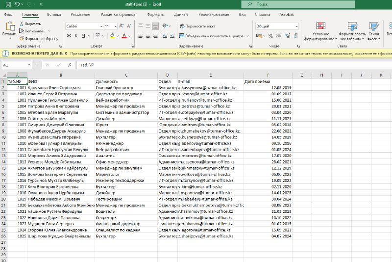
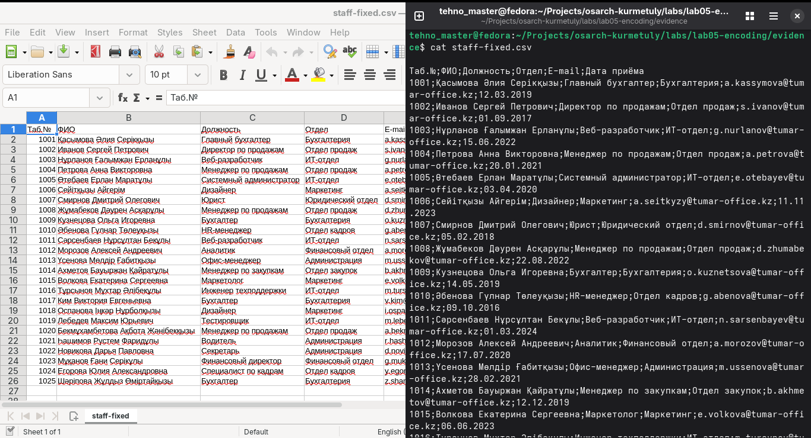

# Lab 5 — Encoding forensics

Pair: Zhiger      Driver first half: Zhiger
Machine: Ubuntu VM on fedora OS
Date: 12.11.26

## Diagnosis 
file says: staff-broken.csv: Non-ISO extended-ASCII text, with CRLF line terminators
First 16 bytes:

| offset | bytes | what they are |
| --- | --- | --- |
| 00 | d2 | T|
| 01 | e0 | a|
| 02 | e1 | б|
| 03 | 2e | .|
| 04 | b9 | №|
| 05 | 3b | ;|
| 06 | d4 | Ф|
| 07 | c8 | И|
| 08 | ce | О|
| 09 | 3b | ;|
| 10 | c4 | Д|
| 11 | ee | о|
| 12 | eb | л|
| 13 | e6 | ж|
| 14 | ed | н|
| 15 | ee | о|

Encoding: RK1048 — evidence: reads correctly
Line ending:  CRLF   — evidence: ^M$ at the end
BOM: absent — evidence: file doesn't start with 'EF BB BF'

## What each application was doing wrong
Excel:        assumed cyrillic encoding because of file encoding
LibreOffice:  Not showing kazakh letters
cat: Showing question marks in diamond shaped

## Fix
Command / script:  scripts/fix.sh
Changed: line ending changed to CRLF;
BOM added because excel shows random symbols otherwise

## Verification
file after: staff-fixed.csv: Unicode text, UTF-8 (with BOM) text, with CRLF line terminators
Opened in:    Excel 2021, LibreOffice Calc 26.2.6.3, cat on Ubuntu 26.04

— evidence/opens-correctly.png

## Evidence

- [evidence/staff-broken.csv](evidence/staff-broken.csv) — broken file
- [evidence/file-before.txt](evidence/file-before.txt) — type of file
- [evidence/hexdump-before](evidence/hexdump-before.txt) — the dump of the file
- [evidence/file-after.txt](evidence/file-after.txt) — after fix
- [evidence/staff-fixed.csv](evidence/staff-fixed.csv) — fixed file
- [evidence/opens-correctly.png](evidence/opens-correctly.png) — libre and cat show correctly
